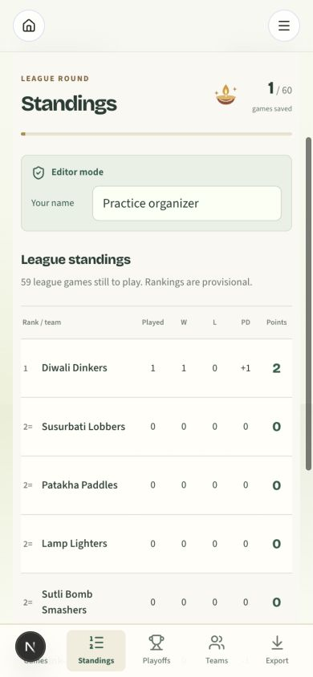
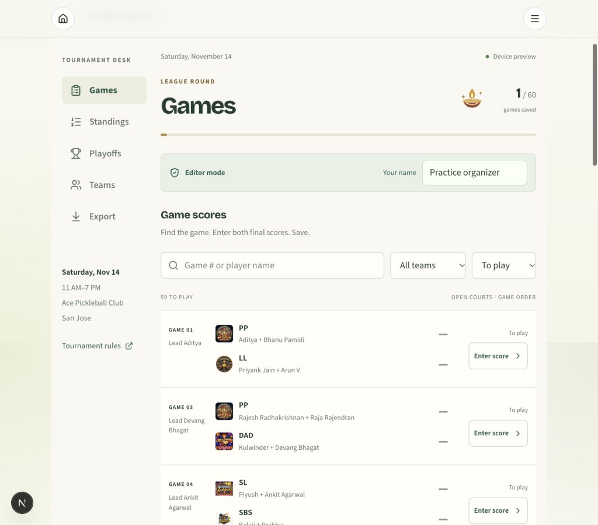

# Tournament scoring acceptance test plan

## Automated checks

Run `pnpm lint`, `pnpm typecheck`, `pnpm test`, then `pnpm build` with the existing Clerk publishable key. CI uses a synthetic public key for compilation only. No tests need or modify a live database.

The suite covers all 625 score combinations from 0–24 in both orientations, raw-input typos, bonus boundary, corrected standings, 60 official fixtures, all 30 player positions, playoff pair coverage, seed ordering, exact ties, swap limits and phase locks, tiebreaks/corrections, and a complete 80-game tournament. Store tests cover stale responses, concurrent editors, double taps, lost responses, browser reload, invalid server data, unavailable storage and legacy practice roster corrections. Workbook tests reload exported Excel data and independently evaluate formulas after changing scores. SQL integration tests apply every migration to an isolated PGlite PostgreSQL engine and check persistence, audit atomicity, rollback, stale writers, operation replay and forged/invalid requests.

## Required before live use

Use a **separate staging database** for live acceptance, with the same Railway application configuration. Keep test scores out of the real tournament. Do not reset or drop the existing community database.

1. **Public viewing and permissions:** Open the live Scores URL in a signed-out browser. Verify standings and lineups load, with no score-entry controls. Sign in as an ordinary Clerk account: still read-only. Sign in with an email listed in `lib/tournament12/editors.ts`: entry controls appear. Remove that email from the list, redeploy, and verify a direct POST and UI save are denied. An empty list must deny every write. Confirm the existing feedback/admin/players/rules pages still work.
2. **Shared saving:** Use two devices. On one save Game 1 at 21–14; verify the other updates within 15 seconds or on refresh. The winner gets 3 win-points and +7 PD, the loser 0 and −7. Correct to 21–15: bonus disappears, winner gets 2 points and +6 PD. Refresh/reopen both devices: the correction remains.
3. **Invalid scores and typos:** Try blank, negative, decimal, scientific notation, letters, a pasted sentence, 24–22, 21–20, 22–21, and tied scores. None may save. Verify 21–0, 21–19, 22–20, 23–21, and 23–22 save in either orientation. Check the team/winner preview before saving. Name is required for every operation.
4. **Lost connection:** Type an unsaved entry, switch to airplane mode, and try saving. It must never claim Saved. Restore the network and refresh. Interrupt a request immediately after tapping Save; if it is unconfirmed, reload the browser and tap **Check save**. Exactly one result/revision/audit event must exist. The pending save must block another save until resolved. Cached data must be marked stale/offline.
5. **Concurrent correction:** Load the same revision on two devices. Save on the first, then immediately save from the second before refreshing it. The second should be asked to review the newer state. Confirm neither result disappears. If polling refreshed the second already, test with its network request paused before releasing it.
6. **League and qualification:** In practice, load League complete, inspect standings, and confirm seeds. Teams cannot move above a team with more win-points or, for equal points, a greater differential. Teams tied on both need the organizers' played tiebreak decision. Confirm all 60 games are required before advancing and exactly four teams qualify. The app does not invent a multi-team tiebreak procedure.
7. **Position swaps:** Load Semifinals setup. Swap P1/P3 for one team, check the named pairings, then publish lineups. League names/results must remain unchanged; further semifinal swaps must be blocked. Complete the semifinal games, set up finals, and use a remaining swap. A third total swap for that team must be blocked. All four qualifying teams need lineups, including third-place teams.
8. **Playoffs:** Semifinals must be 1v4 and 2v3. Pairs are 12/34/15/23/45; finals and third place use 13/24/14/25/35. Both five-game series must finish before advancing. Verify win-points, bonus and PD decide the series, including a case where the majority of games alone would give a different winner. A tie on win-points and PD must require a recorded tiebreak. Distinct positions P1–P5, final score 15–0 through 15–14. Correcting an ordinary series score must invalidate its earlier tiebreak. Earlier round scores stay locked after advancing.
9. **Exports and fallback:** From a partly scored tournament export `.xlsx`, import into Google Sheets and check all 11 tabs. Change a score in the workbook: win-points and league standings must recalculate; clear both score cells and verify it becomes unplayed. Names that start with `=` must remain text. If configured, test direct Google OAuth on a phone; check cancellation, blocked popups and network loss. Never show a success link for an unconfirmed/partial spreadsheet. CSV and JSON backup remain available. Spreadsheet edits must not affect the app.
10. **Phone/tablet:** Test physical Safari on iOS and Chrome on Android, portrait and landscape, plus the intended tablet. Verify numeric keyboards, at least 16px input text, touch targets, long player names, no sideways page scrolling, usable zoom, keyboard-dismissal and bottom navigation. Switch tabs after scrolling deeply; the new section's heading must be visible. Test 320px, 390px, 768px and 1024px layouts. Browser viewport emulation does not replace physical device testing.
11. **Recovery rehearsal:** Download a workbook and JSON backup before advancing. Agree which organizer owns the backup. If switching to Sheets, have all nine editors switch together. Confirm the owner can inspect revision audits and has a database backup; do not manually replay JSON against the live database during the event without review.

## Rule confirmations with organizers

Normal rally scores are 21–0 to 21–19, 22–20, 23–21 or 23–22. A winner earns 2 win-points plus 1 when the loser has 14 or fewer. Tiebreak entry currently treats 15 as a hard cap (15–14 is valid), consistent with the published special tiebreak description. Confirm that point and agree a procedure for a three-or-more-team exact league tie before Saturday.

## Validation boundary

Local automation tests PostgreSQL semantics in PGlite, not Railway networking or the external PostgreSQL driver over a remote connection. Clerk login, allowlist revocation, Google consent and real-device network/keyboard behavior require the staging checks above. Record the person, device, date and outcome of each check before deciding the app is ready for the tournament.

## Local verification recorded November 12, 2026

- 41 automated tests passed, including the complete tournament through the PostgreSQL transaction service; lint, type checking and production build passed on Next.js 16.4.6. The build used a synthetic Clerk publishable key, not a live account.
- Production dependency audit reported zero known vulnerabilities after compatible framework, Clerk, Tiptap, sanitizer and validation updates.
- Browser practice check: 21–20 was blocked, 23–22 saved, and standings showed 2 win-points and +1 differential for the winner.
- Standings fit 320px and 390px browser viewports; the 1024px layout keeps score entry beside the sidebar. Physical device testing remains pending.

